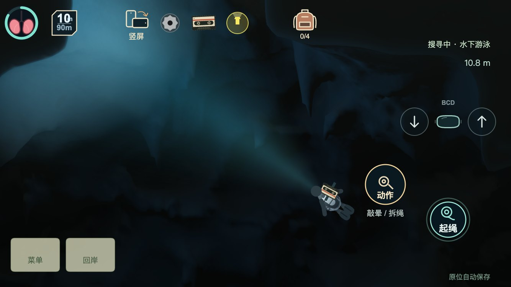
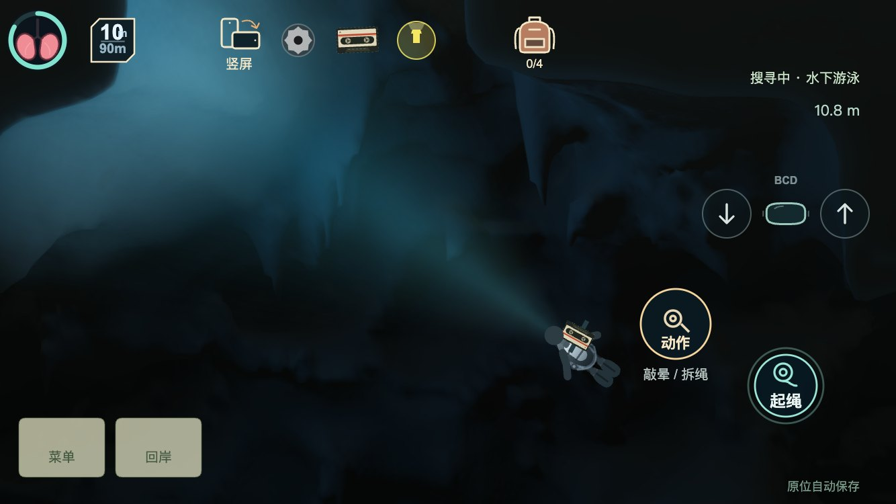
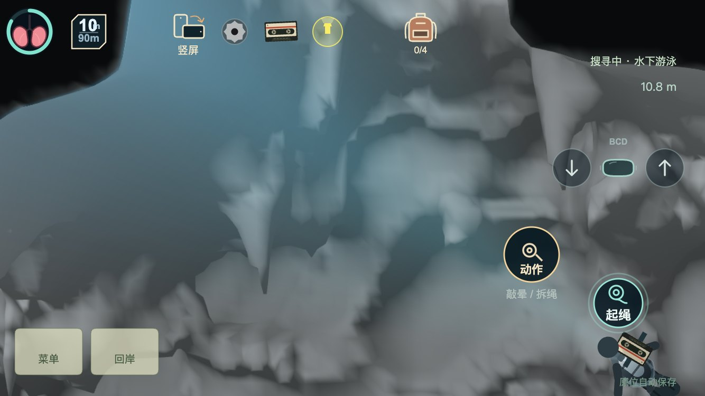
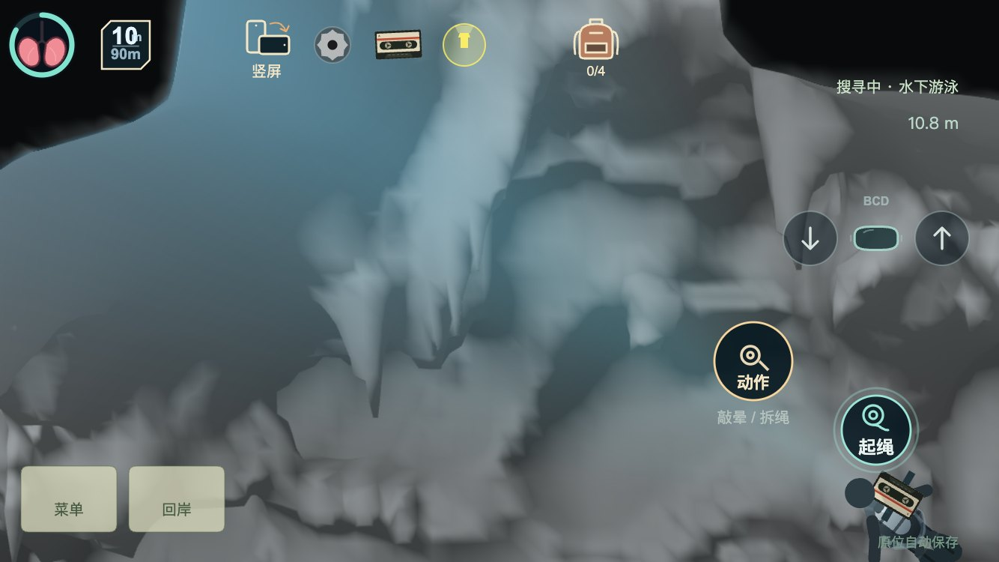

# 洞顶石幔宽褶皱小样 · 2026-11-12

本轮只推进已认可的石幔方向：把单条弯曲厚脊调整为少量不等距、长短错开的垂褶，增加连续的宽根过渡。三根原钟乳石、洞室主体和灯光参数保持原样。**这是待美术评审的小样，默认地图仍使用上一版。** 主角制作方式尚待共同确定，本轮没有继续制作被否定的人物。

形体源在 `src/world/KarstSpeleothems.ts`：六个明确控制节点分别决定纵深位置、横向偏移、垂坠长度和宽度，再用连续曲线连接。仅显式指定 `profile: 'folds'` 时启用。保留已有洞顶扫描落根、局部权重和最大沉积长度，不增加全图采样层数，不改变 z=0 玩法切面。

## 实际游戏对照

种子26110941，同一机位、角色位置与灯光。截图来自真实 `game.ts + src`，保留HUD；灰模用已有几何检查模式，不能当作正常曝光效果。

| 上一版 | 宽褶皱小样 |
| --- | --- |
|  |  |
|  |  |

```sh
npm run shaders
npm run karst:preview
```

本地静态服务器60972运行时，打开 `/node_modules/.cache/karst-review/live/game.html?speleothems&folds`。进入“本轮定格机位”，用“宽褶皱小样 / 上一版对照”在相同机位切换。原有“沉积样例 / 原洞形”是另一个对照，不代表上一版石幔。点击“定格 / 继续游动”后可实际游动；再点本轮机位回到造型检查。

此次只看一处样例；不同种子原洞顶可能遮挡或削弱其效果。新 profile 不存档，重新进入恢复默认样例。

## Blender 检查

Blender 5.3.0 已通过独立后台进程导入前后两份**实际运行网格**，生成可编辑 `.blend` 和正视/斜视灰模。没有重造一份更光滑的替代模型，也没有覆盖用户打开的会话。原始制作源仍是上述受控形体参数；这些 `.blend` 是检查场景，不是手工雕刻母版。

```sh
node scripts/checkDraperyStudy.js --export --seed 26110941
/Applications/Blender.app/Contents/MacOS/Blender -b --factory-startup \
  --python design/cave-room/drapery-study/import_review.py -- \
  --input node_modules/.cache/drapery-study/mesh-folds.json \
  --output-prefix node_modules/.cache/drapery-study/blender-folds \
  --target 6110 1760 210 --span 580 --render
```

将两处 `folds` 换为 `before` 可重建原版。导入只换坐标、设置检查材质，并让三角绕序与游戏给定法线一致；不细分、不平滑位置。报告记录来源哈希、顶点/三角数和绕序调整数。Blender 棚灯仅用来检查空间关系，不冒充游戏手电效果。所有完整网格快照、`.blend`、渲染图和日志留在已忽略缓存；本目录只保留复现脚本与四张紧凑游戏对照图。

## 已验证及尚未完成

- 五种子完整碰撞场与既有指纹一致；样例周边81块的577,809个共享场节点、25,036个双向共享顶点/法线一致。范围外12,104,850个样本不变，0丢面，重复生成一致。seed0此位置没有可见表面改变，另外四种子有变化。
- `node design/cave-room/drapery-study/capture.cjs` 检查真实游戏前后对照、静止缓存、转灯不重建、关灯截图、短游动无穿墙及图形恢复。输出在同一缓存目录。
- 类型检查、纯代码候选包体检查通过（约2.04MiB）。未增加运行贴图或全图采样密度；桌面结果不代表微信真机帧率。
- 自检可读出主褶及厚薄变化，但正常手电下的层次弱于灰模。近看薄边、尖端仍有采样折线，局部根部被前景岩壳遮挡。**没有完成尖端精度、全部挂根或最终美术验收。** 后续应先看这处实际游动，再决定是否局部细分；不要通过增加噪声或全室曝光掩盖限制。
